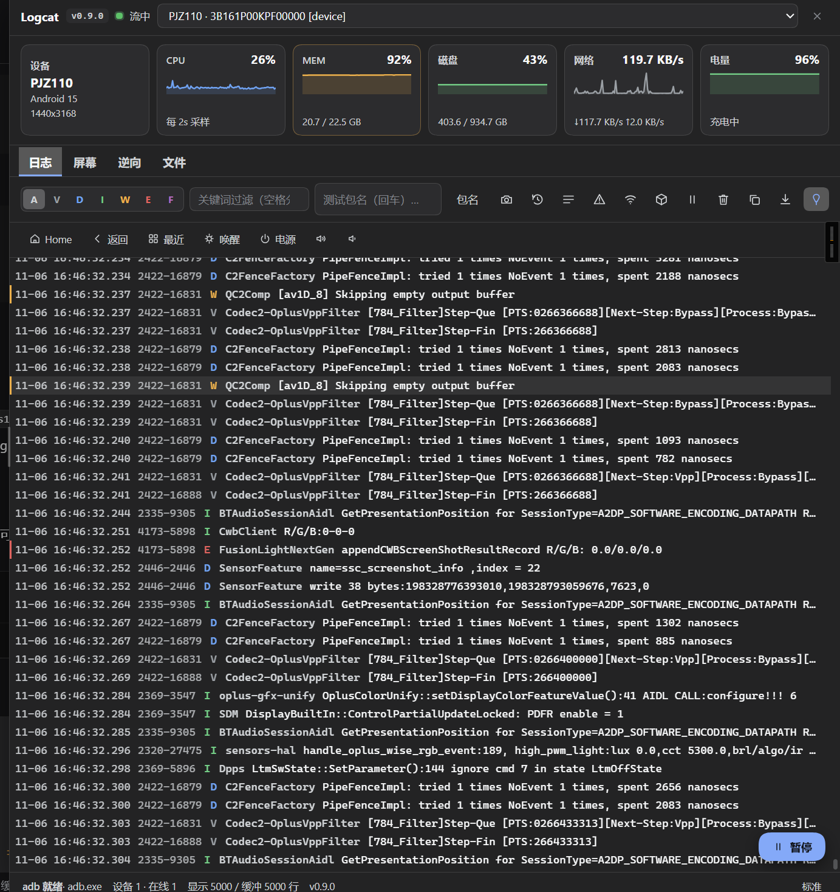
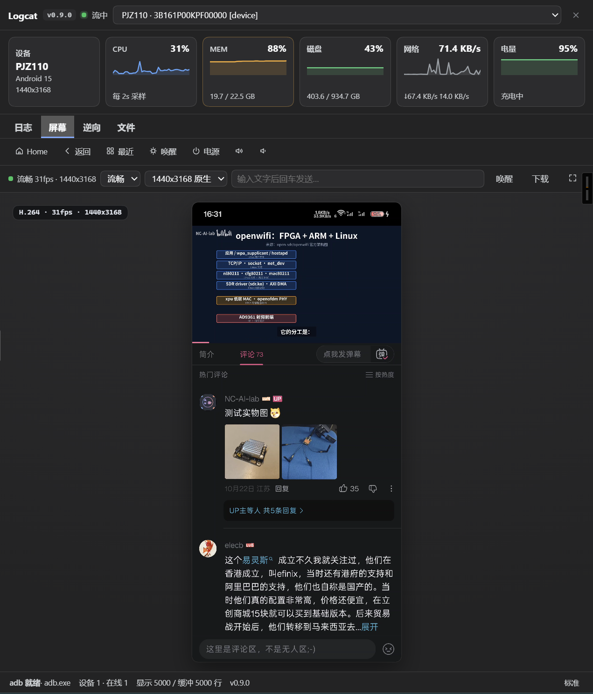
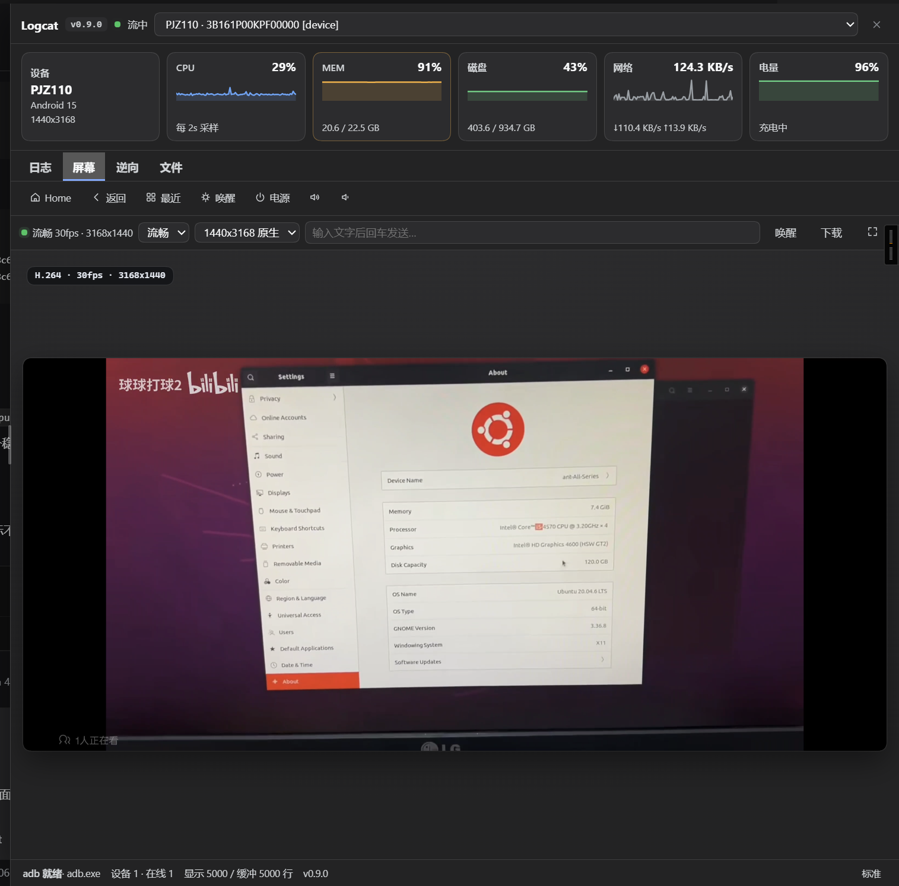
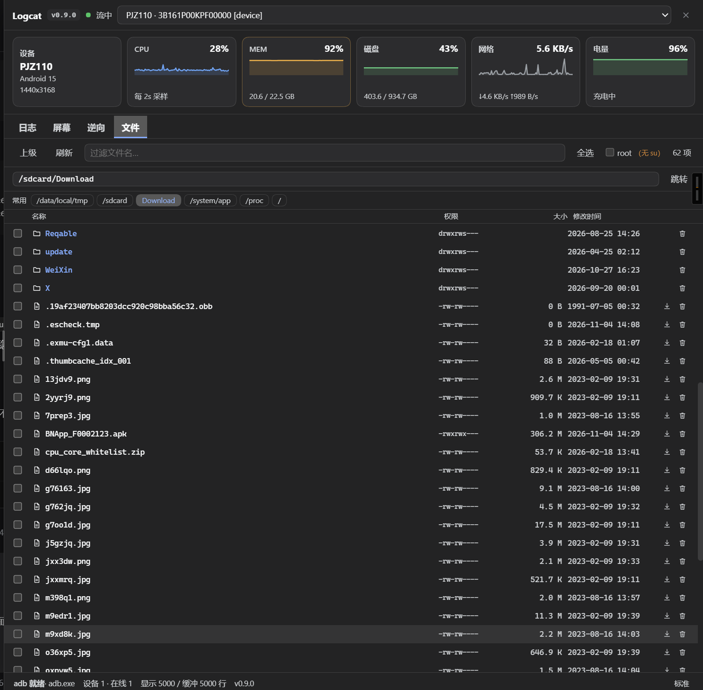
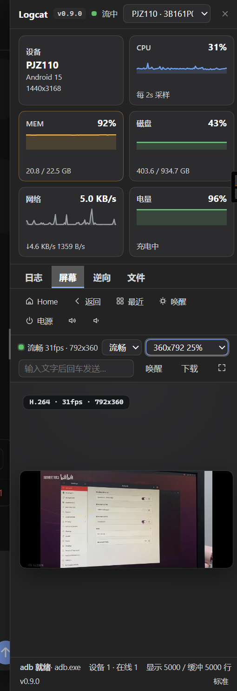

# dsh-logcat

[](https://github.com/deepseek-ai/deepseek-harness)
[](https://github.com/Genymobile/scrcpy)
[](LICENSE)
[]()

`dsh-logcat` is an **on-device Android debugging and reverse-engineering workbench** built
for the [DeepSeek Harness (DSH)](https://github.com/deepseek-ai/deepseek-harness) Web GUI.

It gives you live logcat, real-device screen casting with desktop control, on-device file
browsing, and a process/memory reverse-engineering workbench — and exposes the same
capabilities to the model as **30 agent tools**, so an agent can deploy an APK, watch the
log, catch crashes and drive the UI itself.

> **Current version: 0.9.1.** This release rebuilds the status strip into **six metric
> cards** (device / CPU / MEM / disk / network / battery), adds **disk usage** and **live
> network throughput**, and fixes a blank-panel render crash, a shifted network counter
> parse, and misaligned card titles.
>
> **Compatibility**: targets DSH **0.2.1-rc.5**, Node.js ≥ 22.19.
> Uses the DSH 0.2 `sidebar.panellist` / `main` panel seats and the
> `window.__ModuleLoader__.load({id, factory})` client bundle format.

## 🆕 0.9.1 highlights

- **Six metric cards**: the strip is now a responsive card grid — device / CPU / MEM /
  disk / network / battery — one row wide, collapsing to 3 / 2 / 1 columns by **container
  query on the panel's own width** (not the viewport's).
- **Disk usage**: `stat -f -c '%S %b %a' /data` (block size, total blocks, free blocks).
  `df /data` on this device resolves to an `/apex` mount, not the data partition.
- **Live network throughput**: reads the default-route interface (`wlan0` on Wi-Fi,
  `rmnet_*` on cellular) from `/proc/net/dev`; the client diffs successive samples every
  2 s. Headline is the combined rate, the detail line splits `↓x/s ↑y/s`.
- **Blank panel fixed**: `Spark()` called `Math.random()` during render to build an SVG
  gradient id. That side effect took the whole React tree down — the sidebar entry stayed,
  but clicking it opened nothing. Replaced with a flat area fill; no per-render id.
- **Network value fixed**: `/proc/net/dev` pads counters with spaces *after* the interface
  name, and `tr -s ' ' | cut -d' ' -f2,10` read the interface name as the rx counter, shifting
  every field. It also summed dormant interfaces with non-resetting counters. Now reads the
  default-route interface only.
- **Alignment and stray separator**: card titles share one top edge; the device tile shows
  model / Android version / resolution on three separate lines (the `·` separator used to
  strand at the end of a wrapped line as a lone dot).
- **Bundled input injector removed**: Android 15 kills it at startup (executable dex under
  `app_process` is restricted). The scrcpy control channel covers the same need.

---

## 🌟 Features

- 📡 **Auto-connect and self-installing adb**: probes `ANDROID_HOME` / `ANDROID_SDK_ROOT` /
  the default SDK path / `PATH` / `~/.dsh/adb`, polls `adb devices -l` every 2 s, and attaches
  the logcat stream of any debuggable device automatically. When adb is missing the status
  bar offers a one-click install (USTC mirror, Google fallback).
- 📊 **Six metrics, sampled every 2 s**:
  - **Device**: model / Android version / resolution
  - **CPU**: normalised from `top`'s aggregate line (`800%cpu … 625%idle` on an 8-core
    phone), with a sparkline
  - **MEM**: `/proc/meminfo` used / total / percent, highlighted above 85%
  - **Disk**: `/data` usage and percentage, highlighted above 90%
  - **Network**: default-route interface throughput with a trend line
  - **Battery**: level and charging state
- 📜 **Live log stream**: WebSocket push with a 2000-line ring buffer per device and
  exponential-backoff reconnect. Level filter (V/D/I/W/E/F, Android Studio colours),
  space-separated multi-keyword filter (any hit), a **test package** field shared with the
  agent tools, and red highlighting for fatal/ANR lines.
- 🖼️ **Screen casting and desktop control** (`屏幕` tab):
  - **H.264 via WebCodecs hardware decode**, encoded on the device by the **official
    scrcpy-server v3.3.1**, which is **vendored with the plugin** — no local scrcpy install.
  - The server owns its `MediaCodec`, so there is **no 180-second `screenrecord` cap and no
    reconnect every 3 minutes**; static scenes hold with `KEY_REPEAT_PREVIOUS_FRAME_AFTER`
    instead of starving the encoder.
  - **Resolution tiers derived from the device panel** (native / 75% / 50% / 37.5% / 25%,
    bitrate scaled by pixel count), with smooth (video) and sharp (PNG) modes.
  - **Follows rotation**: a landscape device streams WxH-swapped, full frame, no letterbox,
    with touch coordinates remapped to the current orientation.
  - **Low-latency input** through scrcpy's **control channel**
    (`InputManager.injectInputEvent`, one write on a long-lived socket): measured **2–3 ms**
    per tap. Without an active stream it falls back to `adb shell input` (a Java VM boot per
    call, ~730 ms).
  - **Controls**: click = tap, drag = swipe, **wheel = scroll**, **right-click = BACK**,
    long-press, double-click, **physical keyboard passthrough** (Enter/Backspace/Esc/arrows/
    Tab mapped), an IME text box for Chinese, quick keys (Home/Back/Recents/Wake/Power/
    Volume), one-click frame download, and fullscreen.
- 📂 **On-device file browser** (`文件` tab): walk directories and **climb back to `/`**
  (`/data/local/tmp` is a starting point, not a fence). A **permissions column is always
  visible**; each row reveals **download** (streamed, ≤256 MB) and **delete** (with a
  confirmation and a refusal to delete `/` or top-level directories) on hover. Symlinks show
  their target; path jump bar, bookmark chips, live filename filter and multi-select.
- 🔬 **Reverse-engineering workbench** (`逆向` tab): process list → **module map**
  (so name / base / permissions, click a base to dump) → hex or string memory search →
  dump at a match → manual address + length dump, with a **hex + ASCII** two-column view.
  Backed by the `frida_server` and `frida_script` tools.
- 💥 **Crash snapshots**: a `FATAL EXCEPTION` or `ANR` in the stream triggers an automatic
  screenshot plus 150 context lines under
  `~/.dsh/logcat/crashes/<serial>/<timestamp>-<FATAL|ANR>/` (`screenshot.png`, `crash.log`,
  `meta.json`); the panel shows a banner and keeps the history browsable.
- 🕘 **History**: logs roll to disk per device per day, so a GUI restart loses nothing; the
  panel merges the disk tail with the live buffer, de-duplicated by timestamp.
- 📶 **Wireless debugging**: IP / port / pairing code drives `adb pair` + `adb connect`
  (Android 11+).
- 📦 **APK install, screenshots, export**: stream-installs a local APK (1 GB cap),
  captures the screen to PNG, and pause/resume/clear/copy/export the log view.
- 🧩 **Panel shape**: a **right-hand drawer** by default (overlays the conversation, so a
  glance costs no layout switch), **resizable and remembered**. For a persistent panel, run
  `window.__DSH_LOGCAT_NATIVE_PANEL__ = true` in the console and reload to mount through the
  official `main` + `sidebar.panellist` seats.
- 🎨 **Design language**: host `--dsw-*` tokens first, a single accent colour, bundled SVG
  icons (no icon pack, no emoji), monospace + `tabular-nums` log rows.
- 🗄️ **Bounded persistence**: 64 MB per part, 14-day retention, 512 MB per device by
  default — override with `DSH_LOGCAT_DAY_MB`, `DSH_LOGCAT_RETAIN_DAYS`,
  `DSH_LOGCAT_MAX_MB`, or disable entirely with `DSH_LOGCAT_PERSIST=off` (the stream and the
  agent tools keep working).

---

## 📸 Showcase

| 1. Live log stream (level / keyword / package) | 2. Casting and control (portrait) |
| :---: | :---: |
|  |  |
| **Six metric cards, monospace rows, crash highlighting** | **H.264 hardware decode at native 1440x3168** |

| 3. Rotation follows automatically (landscape) | 4. On-device file browser |
| :---: | :---: |
|  |  |
| **Stream swaps to 3168x1440, full frame, no letterbox** | **Permissions column, breadcrumbs, download/delete, multi-select** |

| 5. Narrow panel collapses responsively |
| :---: |
|  |
| **Container query folds to two columns, title baselines still aligned** |

---

## 📋 Architecture

```
Android device (adb over USB or Wi-Fi)
  │
  ├─ logcat subprocess ─────────▶ AdbEngine (lib/index.js)
  │    (-v threadtime)              │  2000-line ring buffer per device
  │                                 │  daily files + volume roll + retention
  ├─ scrcpy-server (v3.3.1) ───────┤
  │    ├─ video socket  → H.264     │  ScrcpyVideoFramer (12-byte frame header)
  │    └─ control socket ← input    │  ScrcpyController (touch / keycode)
  │                                 │
  ├─ adb shell (stats/files/RE) ────┤  collectStats (all metrics in one round-trip)
  │                                 │  listRemoteDir (ls -la → permissions/size/time)
  │                                 ▼
  │                         HTTP routes /api/dsh-logcat/*
  │                         WebSocket /api/dsh-logcat/stream
  │                                 │
  │                                 ▼
  │                         DSH Web GUI
  │                           └─ lib/client.js (React, no build step)
  │                                 sidebar entry + right-hand drawer
  │                                 tabs: log / screen / RE / files
  │                                 six metric cards (container-query responsive)
  │
  └─ ctx.tools ──▶ 30 agent tools (logcat_* / adb_* / input_* / proc_* / mem_* / frida_*)
```

---

## 🚀 Installation

This is a standard DSH bundle package declaring `dsh.bundle.patch` and `dsh.client`, so the
official CLI installs and mounts it in one line.

### 1. From npm (recommended)

```bash
dsh plugin --profile web add dsh-logcat
```

Updating (it does not self-update; the panel and agent notice report a newer version):

```bash
dsh plugin --profile web update          # latest within the current major
# or pin the newest: dsh plugin --profile web add dsh-logcat@latest
```

> Restart the GUI (`dsh web`) after updating.
>
> **Uninstall**: `dsh plugin --profile web remove dsh-logcat`

### 2. Link a local checkout (development, hot)

```powershell
dsh plugin --profile web add link:<absolute path to this directory>
```

### 3. Optional: GitHub Packages mirror

The same package is mirrored to GitHub Packages for environments that only hold GitHub
credentials. Two caveats:

- **Install requires auth**: the GitHub Packages npm registry needs a token
  (`read:packages`) even for public packages.
- **Only the `latest` dist-tag** exists there.

```ini
# ~/.npmrc
//npm.pkg.github.com/:_authToken=${GITHUB_TOKEN}
```

Maintainer publishing (both scripts read credentials automatically — from the environment
when present, otherwise by dot-sourcing the portable loader
`$env:DSH_HOME\env\load-secrets.ps1`; secrets only ever enter the process environment):

```powershell
./publish-npm.ps1                 # → npmjs.org (primary, needs NPM_TOKEN)
./publish-github-packages.ps1     # → GitHub Packages (needs GH_TOKEN: write:packages)
```

---

## ⚙️ Dependency resolution (three channels)

| Dependency | How it resolves |
|---|---|
| `ws` | junction in this directory's `node_modules`, installed under `.pnpm` |
| `react` / `react-dom` | same (the host injects them on the browser side, as singletons) |
| `@deepseek-ai/dsh-tools` | **must** be declared in `package.json` `peerDependencies`, resolved by the host |

The last one is mandatory. For a `link:` install, DSH routes bare specifiers through
`dsh-app-boot`'s `routeLinked`: the host only applies peer interception when the importer's
**own `package.json` lists the name in `peerDependencies`**. Otherwise native Node resolution
takes over, finds nothing on the way up from `lib/` to the host's `app.asar`, and throws:

```
Error [ERR_MODULE_NOT_FOUND]: Cannot find package '@deepseek-ai/dsh-tools'
imported from .../lib/index.js
```

The symptom is that **neither half activates** and the GUI reports a failed enable.

```json
"peerDependencies": {
  "@deepseek-ai/dsh-tools": ">=0.2.0-rc.1 <0.3.0-0",
  "react": "^18.2.0",
  "react-dom": "^18.2.0"
}
```

> Keep the range aligned with the host's major line. A wrong range fails as
> "incompatible"; a missing one fails as "package not found" — different causes, different fixes.

---

## 🤖 Agent tools (30)

All exposed to the model and advertised in the system prompt.

### Device and execution

| Tool | Description |
| :--- | :--- |
| `logcat_devices` | list attached devices (serial / model / state) |
| `device_info` | model / brand / version / SDK / resolution / ABI / memory / battery |
| `device_stats` | one-shot CPU / memory / battery sample |
| `app_info` | installed version name / versionCode / APK path |
| `adb_exec` | run an arbitrary adb shell command |
| `adb_install` | install a local APK on the device |
| `adb_pull` | copy a file off the device |
| `app_launch` / `app_stop` | start an app (optionally an Activity) / force-stop (destructive; confirm first) |

### Logs

| Tool | Description |
| :--- | :--- |
| `logcat_recent` | live log filtered by package / level / keyword |
| `logcat_history` | on-disk history (survives restarts) |
| `logcat_crash` | crash / ANR blocks with context |
| `logcat_events` | events buffer (app start / crash / lifecycle) |
| `crash_sessions` | auto-captured crash snapshots |
| `logcat_set_package` | pin the package under test (shared with the panel) |

### Screen and input

| Tool | Description |
| :--- | :--- |
| `screen_capture` | screenshot saved to disk **and attached to the conversation** for multimodal inspection |
| `input_tap` / `input_swipe` / `input_text` / `input_keyevent` | on-device UI automation |
| `ui_dump` | UI hierarchy XML (pair with `input_*`) |
| `activity_current` | current foreground Activity |

### Reverse engineering and memory

| Tool | Description |
| :--- | :--- |
| `proc_list` | process list (pid / ppid / user / name) |
| `proc_maps` | memory map with so module bases |
| `proc_status` | process state / memory summary |
| `proc_smaps` | smaps detail (top regions by Pss) |
| `mem_dump` | read memory at an address as hex |
| `mem_search` | search memory for a hex pattern or string |
| `frida_server` | deploy / start / stop frida-server |
| `frida_script` | generate hook / trace / scan / bypass / dump script templates |

> Reading another app's memory or maps needs root or a debuggable app (`run-as`); the tools
> say so explicitly.

### Typical workflows

**Debug loop**: `adb_install` → `app_launch` → `logcat_set_package` → `logcat_recent` /
`logcat_crash` → `ui_dump` + `input_*` → `adb_pull` for evidence.

**Reverse engineering**: `proc_list` → `proc_maps` for module bases → `mem_dump` /
`mem_search` → `proc_smaps` for the memory profile → `frida_script` + `frida_server` to
instrument.

---

## 🔌 HTTP routes

| Method | Path | Description |
| :--- | :--- | :--- |
| `GET` | `/api/dsh-logcat/status` | devices, version, streaming state, metric snapshot |
| `GET` | `/api/dsh-logcat/stats` | the six metrics (device / CPU / MEM / disk / network / battery) |
| `GET` | `/api/dsh-logcat/video-tiers` | resolution tiers derived from the device panel |
| `POST` | `/api/dsh-logcat/exec` | run shell (prefers the scrcpy control channel) |
| `POST` | `/api/dsh-logcat/keyevent` | send a key |
| `POST` | `/api/dsh-logcat/package` | set the package under test |
| `GET` | `/api/dsh-logcat/screenshot` | capture the screen |
| `GET` | `/api/dsh-logcat/history` | on-disk log history |
| `GET` | `/api/dsh-logcat/crashes` · `/crash-file` | crash snapshot list / read |
| `POST` | `/api/dsh-logcat/install-apk` | upload and install an APK |
| `POST` | `/api/dsh-logcat/install-adb` | install adb |
| `POST` | `/api/dsh-logcat/wifi-connect` · `/wifi-disconnect` | wireless debugging |
| `GET` | `/api/dsh-logcat/files` | list a device directory (with permissions) |
| `GET` | `/api/dsh-logcat/file-get` | download a file (streamed, ≤256 MB) |
| `POST` | `/api/dsh-logcat/file-rm` | delete a file or directory |
| `GET` | `/api/dsh-logcat/root-probe` | detect whether the device has `su` |
| `GET` | `/api/dsh-logcat/processes` | process list |
| `POST` | `/api/dsh-logcat/mem-search` · `GET` `/mem-dump` | memory search / dump |

> Every `/api/dsh-logcat/*` route is **loopback-only**.

---

## 🧪 Verification

```bash
# syntax
node --check lib/index.js
node --check lib/client.js

# host tool registration (30 tools)
node --import ./.tmp/register-stub.mjs selfcheck.mjs
```

`@deepseek-ai/dsh-tools` lives inside the host's `app.asar`, which a bare Node process
cannot read, so `node selfcheck.mjs` fails to import on its own — always run it through the
local stub loader (a verification aid, never shipped).

Development-time regression checks (not shipped):

```bash
node .tmp/check-spark-render.mjs      # Spark rendering / variable shadowing
node .tmp/check-stats-parse.mjs       # metric parsing, asserted against real device output
```

---

## ❓ Troubleshooting

1. **The GUI reports `Cannot find package '@deepseek-ai/dsh-tools'`.**
   - The package is missing from `package.json` `peerDependencies`. See the dependency
     section above. After fixing, **re-enable the plugin row** or restart the host — a failed
     import is not retried by itself.

2. **The sidebar has a Logcat entry but clicking it shows nothing.**
   - A client-side render error unmounted the whole tree. 0.9.1 fixed `Spark()` calling
     `Math.random()` during render. If it still happens, open devtools and read the first
     console error.

3. **Black screen, or very low frame rate.**
   - Make sure the device is unlocked (some devices render nothing while locked). Static
     scenes deliberately drop frames (the encoder holds with
     `KEY_REPEAT_PREVIOUS_FRAME_AFTER`); that is by design.
   - If the tier is too high for the encoder, step down one level (e.g. 50%).

4. **Taps do nothing, or are very slow.**
   - Input prefers the scrcpy control channel, which **requires an active stream**. Without
     one it falls back to `adb shell input` (a JVM boot per call, ~730 ms) — expected, not a bug.

5. **The network card shows 0, or a small number.**
   - It diffs the default-route interface's counters, so an idle device really is near zero.
     Phones' own status-bar readouts use a different sampling instant and scope, so the two
     will never match byte for byte.

6. **The status bar says "no su" and root stays disabled.**
   - This device has no `su`. File browsing still works inside what the `shell` user can read;
     reading another app's memory needs a debuggable app (`run-as`).

7. **The device shows as `unauthorized` in `adb devices`.**
   - Tap "Allow USB debugging" on the phone; the panel says so explicitly.

---

## ⚠️ Limitations

- The device must have USB debugging on and this machine authorised.
- Logcat output may contain sensitive data; the routes are loopback-only.
- `adb shell` commands consume real device resources; confirm destructive actions
  (uninstall, clear data, force-stop) first.
- Reading another app's memory or maps needs root or a debuggable app.

---

## 📁 Files

| Path | Purpose |
| :--- | :--- |
| `lib/index.js` | host half: adb engine, device polling, logcat subprocess, scrcpy video + control, HTTP routes, WebSocket, 30 agent tools |
| `lib/client.js` | browser half: sidebar entry + right-hand drawer (React, no build step), four tabs |
| `lib/scrcpy-server.js` | vendored official scrcpy-server v3.3.1 (base64) |
| `cordis.patch.yml` | profile bundle patch (applied automatically) |
| `tools/scrcpy-server/fetch-server.mjs` | re-fetches the vendored server |
| `docs/images/` | README screenshots |

---

## 📄 License

[MIT License](LICENSE).
