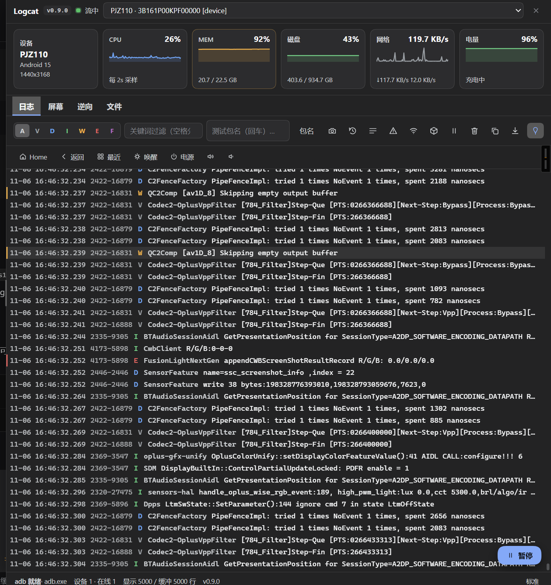
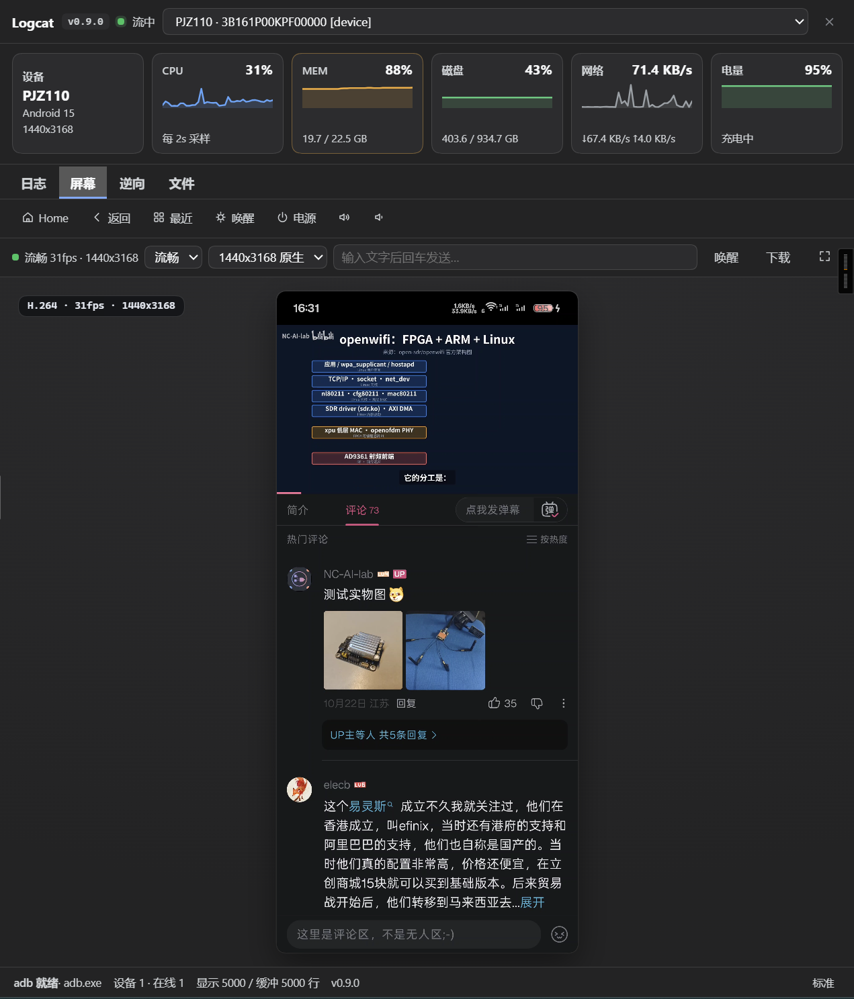
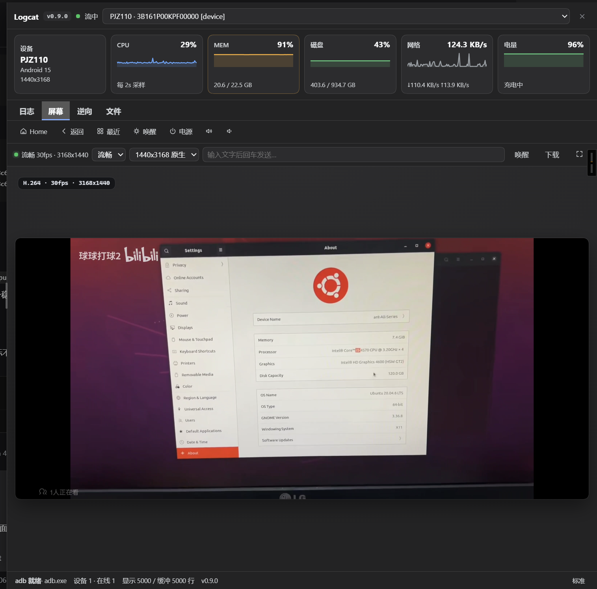
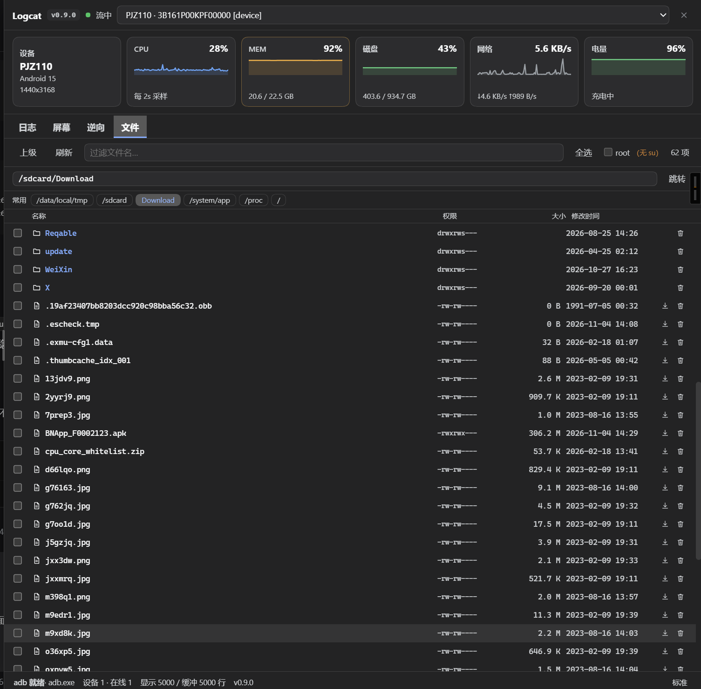
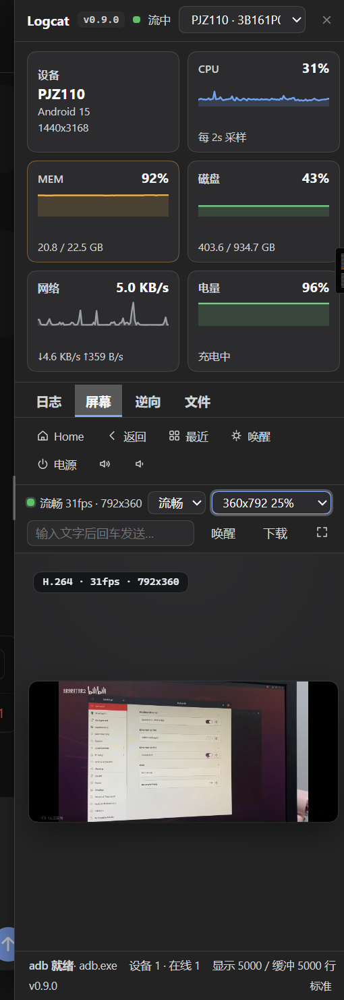
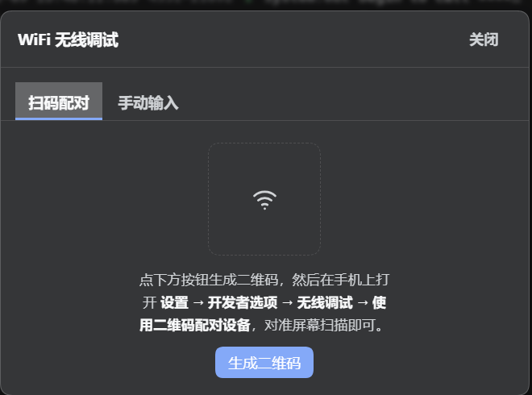
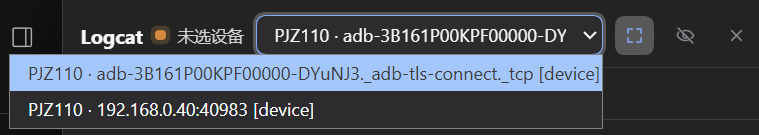

# dsh-logcat

[](https://github.com/deepseek-ai/deepseek-harness)
[](https://github.com/Genymobile/scrcpy)
[](LICENSE)
[]()

`dsh-logcat` 是针对 [DeepSeek Harness (DSH)](https://github.com/deepseek-ai/deepseek-harness) 深度定制的**安卓实机调试与逆向工作台**。

通过本插件，你可以在 DSH Web GUI 里直接完成**实时日志查看、真机投屏与电脑操控、设备文件浏览、进程/内存逆向分析**，并把同一套能力以 **30 个 Agent 工具**开放给模型 —— 构建安卓应用时，模型可以自己部署 APK、看日志、抓崩溃、做界面自动化，形成闭环。

> **当前插件版本：0.9.1**。本次更新：状态栏重构为**六张指标卡片**（设备 / CPU / MEM / 磁盘 / 网络 / 电量），新增**磁盘占用**与**实时网速**；修复卡片渲染导致面板空白、网络计数器字段错位、卡片标题未对齐等问题。
>
> **兼容性**：面向 **DSH 0.2.1-rc.5**，Node.js ≥ 22.19。
> 已适配 DSH 0.2 的 `sidebar.panellist` / `main` 面板挂载与其客户端 bundle 格式（`window.__ModuleLoader__.load({id, factory})`）。

## 🆕 0.9.1 更新摘要

- **六张指标卡片（新）**：状态栏从一行 chip 改为响应式卡片网格 —— **设备 / CPU / MEM / 磁盘 / 网络 / 电量**，一行排开，窄面板按容器宽度自动折成三列 / 两列 / 单列。
- **磁盘占用（新）**：用 `stat -f -c '%S %b %a' /data` 直接读块大小与块数（本机 `df /data` 会错误地落到 `/apex` 挂载点），显示已用/总量与百分比。
- **实时网速（新）**：读取默认路由网卡（Wi-Fi 走 `wlan0`，蜂窝走 `rmnet_*`）的 `/proc/net/dev` 累计计数器，前端每 2s 差分算速率，主值显示收发合计、副标题分方向显示 `↓x/s ↑y/s`。
- **修复面板空白**：`Spark()` 在渲染期用 `Math.random()` 生成 SVG 渐变 id，触发 React 渲染崩溃并卸载整棵面板树（侧栏入口还在，点开却没内容）。改为纯色面积填充，不再生成 id。
- **修复网络值错误**：`/proc/net/dev` 行首有对齐空格，旧写法 `tr -s ' ' | cut -d' ' -f2,10` 取到的是网卡名而非计数，整列错位；且原先累加所有网卡会混入休眠接口的历史计数。现按默认路由网卡单独取值。
- **修复对齐与多余符号**：卡片标题统一顶部对齐，设备卡改为「型号 / 系统版本 / 分辨率」三行独立显示（原先 `·` 分隔符会在换行后落单成一个孤立的点）。
- **移除自研输入注入器**：它在 Android 15 上被系统 `Killed`（`app_process` 加载可执行 dex 受限），scrcpy control 通道已完全覆盖该用途。

---

## 🌟 核心特性

- 📡 **自动连接与 adb 自助**：自动探测本机 adb（`ANDROID_HOME` / `ANDROID_SDK_ROOT` / 默认 SDK 路径 / PATH / `~/.dsh/adb`），每 2 秒轮询 `adb devices -l`；检测到调试设备**自动附加 logcat 流**，无需打开面板。未找到 adb 时状态栏出现「一键安装 adb」按钮，从 USTC 镜像（Google 官方兜底）下载 platform-tools 并接入。
- 📊 **六卡指标 · 每 2s 采样**：
  - **设备**：型号 / Android 版本 / 分辨率
  - **CPU**：由 `top` 的聚合行（如 `800%cpu … 625%idle`）归一化算出使用率，附 sparkline 趋势
  - **MEM**：`/proc/meminfo` 已用/总量与百分比，超 85% 高亮
  - **磁盘**：`/data` 分区占用与百分比，超 90% 高亮
  - **网络**：默认路由网卡实时速率 + 趋势
  - **电量**：百分比与充电状态
- 📜 **实时日志流**：WebSocket 推送，每设备保留最近 2000 行环形缓冲，断线指数退避重连；级别过滤（V/D/I/W/E/F，配色与 Android Studio 一致）、**空格分隔多关键词**任一命中、**测试包名**锁定（与 Agent 工具互通）、崩溃行红色高亮。
- 🖼️ **投屏与电脑操控**（`屏幕` tab）：
  - **H.264 视频流（WebCodecs 硬解）**，编码由**官方 scrcpy-server v3.3.1** 在设备端完成，**内嵌随插件分发，主机无需安装 scrcpy**。
  - server 自持 `MediaCodec`，**没有 `screenrecord` 的 180 秒上限、不会每 3 分钟断流**；静止画面靠 `KEY_REPEAT_PREVIOUS_FRAME_AFTER` 补帧而非停帧。
  - **分辨率档位按设备真实面板生成**（原生 / 75% / 50% / 37.5% / 25%，码率随像素数推算），流畅（视频）/ 高清（PNG）双模式。
  - **自动跟随旋转**：横屏时流尺寸自动交换，画面满屏无黑边，触控坐标同步换算。
  - **低延迟输入**：走 **scrcpy control 通道**（`InputManager.injectInputEvent`，长连接单次写入），实测点击 **2~3ms**；未开投屏时回退原生 `input` 命令（每次启动一个 Java VM，约 730ms）。
  - **操控方式**：点击=点按、拖动=滑动、**滚轮=上下滑动**、**右键=返回**、长按、双击、**实体键盘直通**（字母/数字/符号；Enter/Backspace/Esc/方向键/Tab 映射为对应按键）、中文 IME 输入框、快捷按键（Home/返回/最近/唤醒/电源/音量）、一键下载当前帧、⛶ 全屏。
- 📂 **设备文件浏览**（`文件` tab）：目录可逐级进入，**「上级」可一路回到 `/`**（`/data/local/tmp` 只是初始位置，不是边界）；**权限列常显**（`drwxrwxrws` 等）；每行悬停出现**下载**（≤256MB 流式读取）与**删除**（有确认框，拒绝删除 `/` 与顶级目录）；符号链接显示跳转目标；支持路径直达、常用路径书签、文件名实时过滤、多选。
- 🔬 **逆向工作台**（`逆向` tab）：进程列表 → **自动加载模块地图**（so 名/基址/权限，点基址直接转储）→ 内存 hex/字符串搜索 → 匹配地址转储 → 手动地址+长度转储，转储视图 **hex + ASCII 双列**；配套 `frida_server` 部署与 `frida_script` 模板生成。
- 💥 **崩溃自动快照**：流中出现 `FATAL EXCEPTION` / `ANR` 时自动截图 + 150 行上下文落盘 `~/.dsh/logcat/crashes/<serial>/<时间戳>-<FATAL|ANR>/`（`screenshot.png` + `crash.log` + `meta.json`），面板弹提示条，随时在「崩溃」弹窗查看历史快照。
- 🕘 **历史回溯**：日志按设备按天落盘，重启 GUI 不丢；面板按钮从磁盘加载历史并与实时缓冲**按时间戳去重合并**。
- 📶 **WiFi 无线调试**（Android 11+）：**扫码配对**或**手动输入**两种方式，摆脱数据线。
  - **扫码配对**：电脑生成二维码，手机「设置 → 开发者选项 → 无线调试 → 使用二维码配对设备」一扫即连。二维码内容按 AOSP `AdbQrCode.java` 规范生成（`WIFI:T:ADB;S:studio-…;P:…;;`），`S:` 携带的 mDNS 实例名用于在同一网络的多台设备中精确匹配自己那台。
  - **配对码走 stdin**，不出现在进程列表里（`adb pair` 从 stdin 读取）。
  - **配对 ≠ 可连接**：配对只建立信任，实际连接使用另一个端口，配对成功后自动查找同主机上的 `_adb-tls-connect._tcp` 并连接。
  - **发现失败自动退回手动输入**：若 mDNS 被拦截（AP 隔离 / VPN），界面切到手动 tab，而不是留一个扫不动的码在屏幕上。
  - 会话一次性、仅存内存、120 秒过期。
- 📦 **APK 直装 / 截图 / 导出**：本地选 APK 流式上传安装（1GB 上限）；一键截屏下载 PNG；日志暂停/继续/清空/复制/导出 `.txt`。
- 🧩 **面板形态**：默认**右侧抽屉**（浮在对话之上，看一眼日志不必切布局），**宽度可拖拽并记忆**；想要常驻面板时在浏览器控制台执行 `window.__DSH_LOGCAT_NATIVE_PANEL__ = true` 后刷新，改用官方 `main` + `sidebar.panellist` 挂载。
- 🎨 **设计语言**：宿主 `--dsw-*` 设计 token 优先，单一强调色，内置 SVG 图标集（不依赖图标包、不用 emoji），日志行等宽字体 + `tabular-nums`。
- 🗄️ **有界落盘**：默认 64MB/分卷、保留 14 天、512MB/设备；环境变量 `DSH_LOGCAT_DAY_MB`、`DSH_LOGCAT_RETAIN_DAYS`、`DSH_LOGCAT_MAX_MB` 可覆盖，`DSH_LOGCAT_PERSIST=off` 完全关闭落盘（实时流与 agent 工具不受影响）。

---

## 📸 运行效果展示 (Showcase)

| 1. 实时日志流（级别/关键词/包名过滤） | 2. 投屏与电脑操控（竖屏） |
| :---: | :---: |
|  |  |
| **六卡指标 + 等宽日志行 + 崩溃高亮** | **H.264 硬解，1440x3168 原生档位** |

| 3. 投屏自动跟随旋转（横屏） | 4. 设备文件浏览 |
| :---: | :---: |
|  |  |
| **转屏后流尺寸交换为 3168x1440，满屏无黑边** | **权限列常显、面包屑、下载/删除、多选** |

| 5. 窄面板响应式折叠 | 6. 无线调试扫码配对 |
| :---: | :---: |
|  |  |
| **容器查询按面板宽度折成两列，标题基线仍对齐** | **扫码 / 手动 两个 tab，手机一扫即连** |

| 7. 配对成功后无线设备自动进入列表 |
| :---: |
|  |
| **`_adb-tls-connect._tcp` 由 mDNS 自动发现，无需手填 IP:端口** |

---

## 📋 架构设计

```
Android 设备 (adb / USB 或 WiFi)
  │
  ├─ logcat 子进程 ─────────────▶ AdbEngine (lib/index.js)
  │    (-v threadtime)               │  环形缓冲 2000 行 / 设备
  │                                  │  按天落盘 + 分卷 + 保留清理
  ├─ scrcpy-server (v3.3.1) ────────┤
  │    ├─ video socket  → H.264 帧   │  ScrcpyVideoFramer（解析 12 字节帧头）
  │    └─ control socket ← 输入事件  │  ScrcpyController（touch / keycode）
  │                                  │
  ├─ adb shell（stats / 文件 / 逆向）┤  collectStats（一次往返取全部指标）
  │                                  │  listRemoteDir（ls -la → 权限/大小/时间）
  │                                  │
  ├─ 扫码配对 ──────────────────────┤  lib/qr.js → qrcode-generator
  │    手机扫描 WIFI:T:ADB;S:…;P:…;;  │  buildPairingPayload（一次性凭据）
  │    手机广播 _adb-tls-pairing._tcp │  轮询 mDNS，按 S: 精确匹配
  │    adb pair <host>:<port> ◀ stdin  │  配对码走 stdin，不进进程列表
  │                                  ▼
  │                          HTTP 路由 /api/dsh-logcat/*
  │                          WebSocket /api/dsh-logcat/stream
  │                                  │
  │                                  ▼
  │                          DSH Web GUI
  │                            └─ lib/client.js（React，无构建步骤）
  │                                 侧栏入口 + 右侧抽屉
  │                                 日志 / 屏幕 / 逆向 / 文件 四个 tab
  │                                 六卡指标（容器查询响应式）
  │                                 WiFi 弹窗：扫码 / 手动 两个 tab
  │
  └─ ctx.tools ──▶ 30 个 Agent 工具（logcat_* / adb_* / input_* / proc_* / mem_* / frida_*）
```

---

## 🚀 安装与部署

本插件是标准 DSH Bundle 插件包，声明了 `dsh.bundle.patch` 与 `dsh.client`，通过 DSH 官方 CLI 一行完成安装与自动挂载。

### 1. 从 npm 安装（推荐）

```bash
dsh plugin --profile web add dsh-logcat
```

更新到最新版（不会自动更新；装旧版时面板与 agent 通告会提示）：

```bash
dsh plugin --profile web update          # 升到当前 major 内最新
# 或强制最新：dsh plugin --profile web add dsh-logcat@latest
```

> 更新后重启 GUI（`dsh web`）生效。
>
> **卸载**：`dsh plugin --profile web remove dsh-logcat`

### 2. 源码本地链接（开发用，实时生效）

```powershell
# 把插件链进 profile，然后重启 GUI 一次完成装载
dsh plugin --profile web add link:<本目录绝对路径>
```

### 3. 可选：GitHub Packages 通道

同一份包镜像到 GitHub Packages，适合只愿用 GitHub 凭据的环境。注意：

- **安装必须鉴权**：GitHub Packages 的 npm 源即使对公开包也要求 token（`read:packages`）
- **只支持 `latest` 一个 dist-tag**

```ini
# ~/.npmrc
//npm.pkg.github.com/:_authToken=${GITHUB_TOKEN}
```

维护者发布（两个脚本都会自动读凭据：有环境变量就用，没有就 dot-source 便携版
`$env:DSH_HOME\env\load-secrets.ps1`，凭证只进进程环境、不落盘）：

```powershell
./publish-npm.ps1                 # → npmjs.org（主通道，需 NPM_TOKEN）
./publish-github-packages.ps1     # → GitHub Packages（需 GH_TOKEN: write:packages）
```

---

## ⚙️ 依赖解析（三条通道，别混淆）

| 依赖 | 解析方式 |
|---|---|
| `ws` | 本目录 `node_modules` 下的 junction，真实安装在 `.pnpm` 里 |
| `qrcode-generator` | 同上（零依赖，用于生成扫码配对二维码） |
| `react` / `react-dom` | 同上（浏览器端由宿主注入，单例） |
| `@deepseek-ai/dsh-tools` | **必须**写进 `package.json` 的 `peerDependencies`，由宿主代解析 |

最后一条是硬性要求。DSH 对链接安装（`link:`）的插件按 `dsh-app-boot` 的 `routeLinked`
规则路由裸包名请求：只有当导入方**自己的 `package.json` 把该名字列进 `peerDependencies`**
时，宿主才走「peer 拦截」；否则回落 Node 原生解析，从 `lib/` 一路向上都找不到宿主
`app.asar` 里的包，直接抛：

```
Error [ERR_MODULE_NOT_FOUND]: Cannot find package '@deepseek-ai/dsh-tools'
imported from .../lib/index.js
```

症状是整个插件（宿主半 + 浏览器半）都不激活，GUI 提示「启用失败」。正确写法：

```json
"peerDependencies": {
  "@deepseek-ai/dsh-tools": ">=0.2.0-rc.1 <0.3.0-0",
  "react": "^18.2.0",
  "react-dom": "^18.2.0"
}
```

> 版本区间要与宿主大版本对齐。区间写错时插件会被判「不兼容」而非「找不到包」，
> 两种报错原因不同、修法也不同。

---

## 🤖 Agent 工具（30 个）

全部对模型开放，前置提示中已明示可调用。

### 设备与执行

| 工具 | 说明 |
| :--- | :--- |
| `logcat_devices` | 列出当前连接的设备（serial / 型号 / 状态） |
| `device_info` | 型号 / 品牌 / 版本 / SDK / 分辨率 / ABI / 内存 / 电量 |
| `device_stats` | 一次性采样 CPU / 内存 / 电量 |
| `app_info` | 已安装应用的版本名 / versionCode / APK 路径 |
| `adb_exec` | 执行任意 adb shell 命令 |
| `adb_install` | 安装本地 APK 到真机 |
| `adb_pull` | 从设备拉取文件到本机 |
| `app_launch` / `app_stop` | 启动应用（可指定 Activity）/ force-stop（破坏性，先确认） |

### 日志

| 工具 | 说明 |
| :--- | :--- |
| `logcat_recent` | 按包名 / 级别 / 关键词过滤的实时日志 |
| `logcat_history` | 磁盘历史回溯（重启不丢） |
| `logcat_crash` | 崩溃 / ANR 捕获 + 上下文 |
| `logcat_events` | events 事件缓冲（应用启停 / 崩溃 / 生命周期） |
| `crash_sessions` | 崩溃自动快照历史 |
| `logcat_set_package` | 锁定当前测试包名（与面板互通） |

### 屏幕与输入

| 工具 | 说明 |
| :--- | :--- |
| `screen_capture` | 截图存档并**嵌入对话图片块**，多模态模型可直接看图 |
| `input_tap` / `input_swipe` / `input_text` / `input_keyevent` | 真机 UI 自动化 |
| `ui_dump` | UI 层级 XML（配合 `input_*` 定位控件） |
| `activity_current` | 当前前台 Activity |

### 逆向与内存

| 工具 | 说明 |
| :--- | :--- |
| `proc_list` | 进程列表（pid / ppid / user / name） |
| `proc_maps` | 内存映射 + so 模块基址 |
| `proc_status` | 进程状态 / 内存摘要 |
| `proc_smaps` | smaps 明细（Pss Top 区域） |
| `mem_dump` | 指定地址读内存 hex |
| `mem_search` | 内存搜 hex 模式 / 字符串 |
| `frida_server` | frida-server 部署 / 启停 |
| `frida_script` | hook / trace / scan / bypass / dump 脚本模板生成 |

> 读其他应用的内存 / maps 需要 root 或 debuggable 应用（`run-as`），工具会给出明确提示。

### 典型工作流

**实机调试闭环**：`adb_install` 部署 APK → `app_launch` 启动 → `logcat_set_package` 锁包 →
`logcat_recent` / `logcat_crash` 看崩溃 → `ui_dump` + `input_*` 做界面自动化 → `adb_pull` 取证。

**逆向分析**：`proc_list` 定位进程 → `proc_maps` 拿模块基址 → `mem_dump` 读目标地址 /
`mem_search` 搜特征 → `proc_smaps` 看内存明细 → `frida_script` 生成脚本 + `frida_server` 起 frida 插桩。

---

## 🔌 HTTP 接口

| 方法 | 路径 | 说明 |
| :--- | :--- | :--- |
| `GET` | `/api/dsh-logcat/status` | 设备列表、版本、投屏状态、指标快照 |
| `GET` | `/api/dsh-logcat/stats` | 六项指标（设备 / CPU / MEM / 磁盘 / 网络 / 电量） |
| `GET` | `/api/dsh-logcat/video-tiers` | 按设备面板生成的分辨率档位 |
| `POST` | `/api/dsh-logcat/exec` | 执行 shell（优先走 scrcpy control 通道） |
| `POST` | `/api/dsh-logcat/keyevent` | 发送按键 |
| `POST` | `/api/dsh-logcat/package` | 设置测试包名 |
| `GET` | `/api/dsh-logcat/screenshot` | 截屏 |
| `GET` | `/api/dsh-logcat/history` | 历史日志回溯 |
| `GET` | `/api/dsh-logcat/crashes` · `/crash-file` | 崩溃快照列表 / 读取 |
| `POST` | `/api/dsh-logcat/install-apk` | 上传安装 APK |
| `POST` | `/api/dsh-logcat/install-adb` | 一键安装 adb |
| `POST` | `/api/dsh-logcat/wifi-connect` · `/wifi-disconnect` | 无线调试（手动配对 / 断开） |
| `GET` | `/api/dsh-logcat/wifi-qr` | 生成扫码配对会话（二维码 SVG + 一次性凭据） |
| `GET` | `/api/dsh-logcat/wifi-qr-poll` | 轮询 mDNS 广播并完成 `adb pair` |
| `POST` | `/api/dsh-logcat/wifi-qr-cancel` | 放弃当前二维码会话 |
| `GET` | `/api/dsh-logcat/files` | 列出设备目录（含权限） |
| `GET` | `/api/dsh-logcat/file-get` | 下载文件（≤256MB 流式） |
| `POST` | `/api/dsh-logcat/file-rm` | 删除文件 / 目录 |
| `GET` | `/api/dsh-logcat/root-probe` | 探测设备是否有 su |
| `GET` | `/api/dsh-logcat/processes` | 进程列表 |
| `POST` | `/api/dsh-logcat/mem-search` · `GET` `/mem-dump` | 内存搜索 / 转储 |

> 所有 `/api/dsh-logcat/*` 路由**仅允许 loopback 访问**。

---

## 🧪 验证与自检

```bash
# 语法
node --check lib/index.js
node --check lib/client.js

# 宿主工具注册（30 个）
node --import ./.tmp/register-stub.mjs selfcheck.mjs
```

`@deepseek-ai/dsh-tools` 位于宿主 `app.asar` 内，裸 Node 进程无法读取，因此
`node selfcheck.mjs` 会导入失败 —— 必须走本地 stub loader（仅用于验证，不随包分发）。

开发期的回归单测（不随包分发）：

```bash
node .tmp/check-spark-render.mjs      # Spark 渲染 / 变量遮蔽
node .tmp/check-stats-parse.mjs       # 指标解析（用真机输出做断言）
```

---

## ❓ 常见问题排查 (Troubleshooting)

1. **GUI 提示「启用失败：Cannot find package '@deepseek-ai/dsh-tools'」？**
   - `package.json` 的 `peerDependencies` 没写这个包名。见上方「依赖解析」章节。
     修完需**重新启用插件行**或重启宿主 —— 已失败的导入不会自己重试。

2. **侧栏有 Logcat 入口，点开却空白？**
   - 浏览器端渲染抛错导致整棵树被卸载。0.9.1 已修复 `Spark()` 在渲染期用
     `Math.random()` 生成 SVG id 的问题。若仍出现，打开开发者工具看 Console 的第一条错误。

3. **投屏黑屏或帧率极低？**
   - 先确认设备已解锁（锁屏画面部分机型不渲染）。本插件用的是官方 scrcpy-server，
     静态画面会主动降帧（`KEY_REPEAT_PREVIOUS_FRAME_AFTER` 补帧），这是设计行为。
   - 档位过高时编码器可能吃不住，往下调一档（如 50%）通常即可。

4. **点击没反应 / 延迟很高？**
   - 输入优先走 scrcpy control 通道，**该通道需要投屏正在运行**。没开投屏时会回退到
     `adb shell input`，每次启动一个 Java VM，约 730ms —— 属预期，不是缺陷。

5. **网络卡片显示 0 或数值偏小？**
   - 取的是**默认路由那张网卡**的累计计数器差分。设备静止、无网络活动时确实接近 0；
     与手机状态栏的口径（采样时刻、协议开销、包含的接口）天然不同，不会逐字节一致。

6. **状态栏显示「无 su」，root 选项不可选？**
   - 该设备没有 `su`，root 路径不可用。文件浏览仍可走 `shell` 用户能读的目录；
     读其他应用内存需要 debuggable 应用（`run-as`）。

7. **`adb devices` 里设备是 `unauthorized`？**
   - 需要在手机上点「允许 USB 调试」。面板会明确提示。

8. **扫码配对一直停在「请用手机扫描二维码…」？**
   - 说明主机没收到手机广播的 `_adb-tls-pairing._tcp`。常见原因与对策：
     - **AP 隔离** —— 同一 Wi-Fi 下客户端之间不通 multicast，换网络或用手动输入。
     - **手机没进配对模式** —— 必须点「无线调试 → 使用二维码配对设备」，只是开着「无线调试」不会广播配对服务。
     - **电脑走了 VPN / 代理网卡** —— mDNS 多播被路由到错误的网卡。可临时关掉 VPN 再试。
   - 发现失败时界面会提示并切到「手动输入」tab，可以直接用手机「无线调试」页面显示的
     IP:端口 + 配对码完成同样的流程。

---

## ⚠️ 限制

- 需要设备开启 USB 调试并在手机上授权本机。
- logcat 输出可能含敏感信息；相关路由仅限 loopback。
- `adb shell` 命令消耗真实设备资源，破坏性操作（卸载 / 清数据 / force-stop）应先确认。
- 读其他应用内存 / maps 需要 root 或 debuggable 应用。

---

## 📁 文件

| 路径 | 说明 |
| :--- | :--- |
| `lib/index.js` | 宿主端：adb 引擎、设备轮询、logcat 子进程、scrcpy 流与控制通道、HTTP 路由、WebSocket、扫码配对、30 个 agent 工具 |
| `lib/client.js` | 浏览器端：侧栏入口 + 右侧抽屉（React，无构建步骤），四个 tab |
| `lib/qr.js` | 扫码配对：ADB 配对负载生成 + 二维码 SVG 渲染（基于 `qrcode-generator`） |
| `lib/scrcpy-server.js` | 内嵌的官方 scrcpy-server v3.3.1（base64，随插件分发） |
| `cordis.patch.yml` | profile bundle patch（自动应用） |
| `tools/scrcpy-server/fetch-server.mjs` | 重新拉取内嵌 scrcpy-server 的脚本 |
| `docs/images/` | README 配图 |

---

## 📄 开源许可证

本项目基于 [MIT License](LICENSE) 开源。
